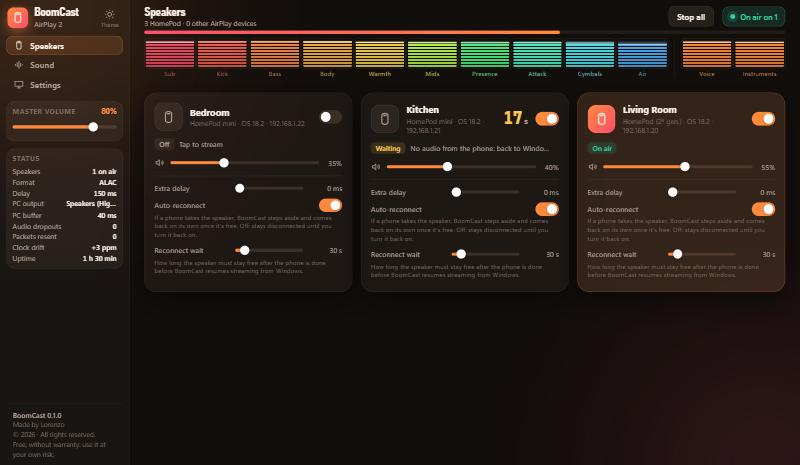
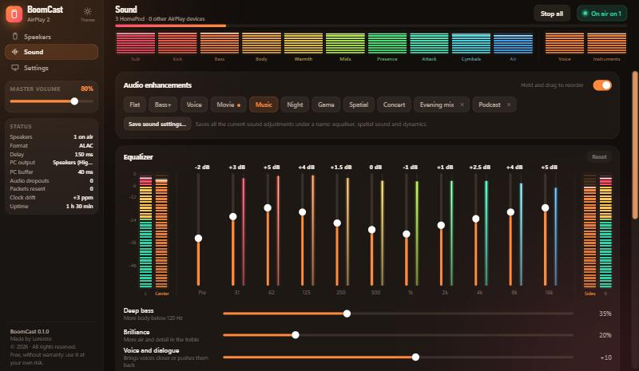
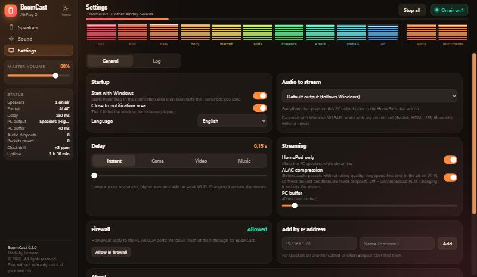

# BoomCast

**Tutto quello che suona sul tuo PC Windows, sul tuo HomePod.**

BoomCast manda l'audio del PC a HomePod e altri altoparlanti AirPlay 2 attraverso la rete di casa. Musica, film, giochi, videochiamate: quello che esce da Windows esce dall'altoparlante. Nessun driver da installare, nessun account, gratis.

**[Scarica BoomCast.exe](https://github.com/Lorenzo8484/BoomCast/releases/latest)** · [Guida](docs/guida.it.md) · *English: [README.md](README.md)*

*Le immagini mostrano l'app in inglese; la lingua si sceglie nelle impostazioni.*

> BoomCast è un progetto indipendente. Non è affiliato ad Apple, né approvato o sostenuto da Apple. AirPlay, HomePod, HomeKit e iPhone sono marchi di Apple Inc.

## Perché BoomCast

Un HomePod suona benissimo, ma Windows non può usarlo: AirPlay è integrato solo nei dispositivi Apple. BoomCast colma questo vuoto. Cattura l'audio del PC mentre viene riprodotto e lo trasmette all'altoparlante, così l'HomePod diventa la cassa del PC per qualsiasi cosa, non solo per un'app di musica.

| | |
|---|---|
| **Qualsiasi suono, qualsiasi app** | Cattura l'uscita di Windows, quindi funziona con browser, lettori, giochi e chiamate senza configurarli uno per uno. |
| **Ritardo basso** | Da 0,15 s. Abbastanza poco per guardare video e giocare; per il Wi-Fi debole c'è un valore più alto. |
| **Senza perdita** | 44,1 kHz / 16 bit, in ALAC (pacchetti più piccoli, meno scatti) o PCM non compresso. |
| **Più altoparlanti** | Ne accendi quanti vuoi; ognuno ha il suo volume e il suo ritardo fine. |
| **Convive con il telefono** | Quando un iPhone suona sull'HomePod, BoomCast si fa da parte e poi torna da solo. |
| **Nessun driver** | Usa la cattura audio già presente in Windows. Non installa niente nel sistema. |

## Altoparlanti

Ogni altoparlante della rete ha la sua scheda: un interruttore per iniziare a trasmettere, il volume, un ritardo extra per allinearlo ad altri altoparlanti o all'immagine, e le opzioni per condividerlo con un telefono.

Quando un telefono inizia a suonare su un altoparlante, BoomCast gli lascia subito il posto. Quando il telefono smette, accanto al nome dell'altoparlante compare un conto alla rovescia (il "17 s" nell'immagine sopra) e allo zero l'audio del PC torna. Quanto dura l'attesa lo scegli tu, per ogni altoparlante.

La colonna a sinistra mostra cosa sta succedendo: quanti altoparlanti suonano, il formato, il ritardo, l'uscita di Windows catturata e lo stato della connessione.

## Suono

- **Modalità audio.** Nove di serie: Neutro, Bassi+, Voce, Film, Musica, Notte, Gioco, Spaziale, Concerto.
- **Ogni modalità si ricorda di te.** Sposti uno slider mentre una modalità è attiva e la modifica resta sua, anche dopo il riavvio. Un puntino arancione segna quelle modificate; **Azzera** riporta quella attiva alla regolazione originale senza toccare le altre.
- **Le tue modalità.** Salvi tutto quello che c'è nella pagina con il nome che vuoi, quante ne vuoi, e trascini i pulsanti nell'ordine che preferisci.
- **Equalizzatore a 10 bande** da 31 Hz a 16 kHz con preamplificazione, più bassi profondi, brillantezza e voce.
- **Suono spaziale:** larghezza stereo, surround, riverbero con dimensione della stanza, fusione dei canali, bilanciamento.
- **Dinamica:** compressione, volume uniforme tra i brani, limitatore contro la distorsione, dithering.
- **Misuratori dal vivo:** in alto lo spettro per banda, ai lati dell'equalizzatore canale sinistro, centro, lati e canale destro, così vedi cosa fa ogni controllo.

## Impostazioni

- **Ritardo** con quattro valori pronti: *Istante* (0,15 s), *Gioco*, *Video*, *Musica*, oppure quello che vuoi con lo slider.
- **Audio da trasmettere:** l'uscita predefinita di Windows o una specifica.
- **Solo HomePod:** silenzia le casse del PC mentre trasmette.
- **Compressione ALAC:** accesa di serie; rende la trasmissione più robusta sul Wi-Fi senza perdere qualità.
- **Avvio con Windows** e **chiusura nell'area di notifica**, dove un piccolo pannello dà interruttori e volume senza aprire la finestra.
- **28 lingue**, scelte da Windows in automatico, e tema chiaro e scuro.
- **Log** di quello che l'app sta facendo, per quando qualcosa non va.

## Requisiti

- Windows 10 o 11 a 64 bit.
- Microsoft Edge WebView2 Runtime (fa già parte di Windows 11 e di Windows 10 aggiornato).
- Un HomePod, HomePod mini o altro altoparlante AirPlay 2 sulla **stessa rete** del PC.
- Nell'app **Casa** di Apple: *Impostazioni casa → Altoparlanti e TV → Consenti accesso → Chiunque sulla stessa rete*.

Sviluppato e provato con un HomePod (2ª generazione). Gli altri altoparlanti AirPlay 2 dovrebbero funzionare ma non sono stati provati.

## Download e primo avvio

1. Scarica `BoomCast.exe` dall'[ultima versione](https://github.com/Lorenzo8484/BoomCast/releases/latest). Non c'è niente da installare: metti il file dove vuoi e avvialo.
2. Il file non ha una firma digitale, quindi Windows mostra *"PC protetto da Windows"*. Scegli **Ulteriori informazioni → Esegui comunque**.
3. I tuoi altoparlanti compaiono in **Altoparlanti**. Accendine uno.
4. La prima volta il firewall di Windows deve lasciar arrivare a BoomCast le risposte dell'altoparlante: premi **Consenti nel firewall** quando l'app lo chiede e conferma la richiesta di Windows. Serve una volta sola.

Ogni impostazione spiegata e un elenco di soluzioni ai problemi: **[Guida](docs/guida.it.md)**.

## Da sapere

- **Scatti sul Wi-Fi.** Con un ritardo molto basso un pacchetto perso sul Wi-Fi non si recupera in tempo e si sente uno scatto. Se succede, alza il ritardo e tieni accesa la compressione ALAC.
- **Le traduzioni** sono automatiche e non sono state riviste da madrelingua. Il log è in italiano.
- **Privacy.** BoomCast parla solo con gli altoparlanti della tua rete locale. Non raccoglie niente e non manda niente su Internet. Le impostazioni restano sul tuo PC, in `%APPDATA%\BoomCast`.
- BoomCast usa AirPlay 2 senza il coinvolgimento di Apple, quindi un futuro aggiornamento del software dell'altoparlante può farlo smettere di funzionare finché BoomCast non viene aggiornato.
- Nelle immagini di questa pagina nomi e indirizzi degli altoparlanti sono inventati.

## Problemi e suggerimenti

Apri una [segnalazione](https://github.com/Lorenzo8484/BoomCast/issues). Indica che altoparlante hai, la versione di Windows, e allega il testo di *Impostazioni → Log*.

## Diritti e responsabilità

© 2026 Lorenzo. Tutti i diritti riservati. BoomCast è gratuito per uso personale; non può essere modificato, decompilato, ridistribuito o venduto senza il permesso scritto dell'autore. È fornito "così com'è", senza garanzie di alcun tipo: lo usi a tuo rischio. Termini completi: [LICENSE.md](LICENSE.md).

Il codice sorgente non è pubblicato. BoomCast contiene librerie open source, elencate con le loro licenze in [THIRD-PARTY-NOTICES.md](THIRD-PARTY-NOTICES.md).
