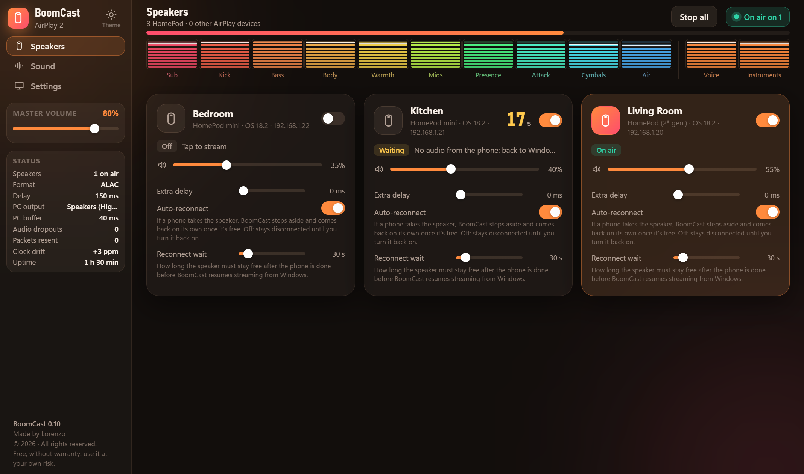
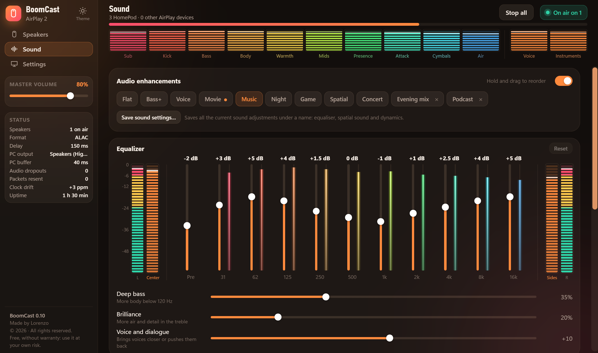
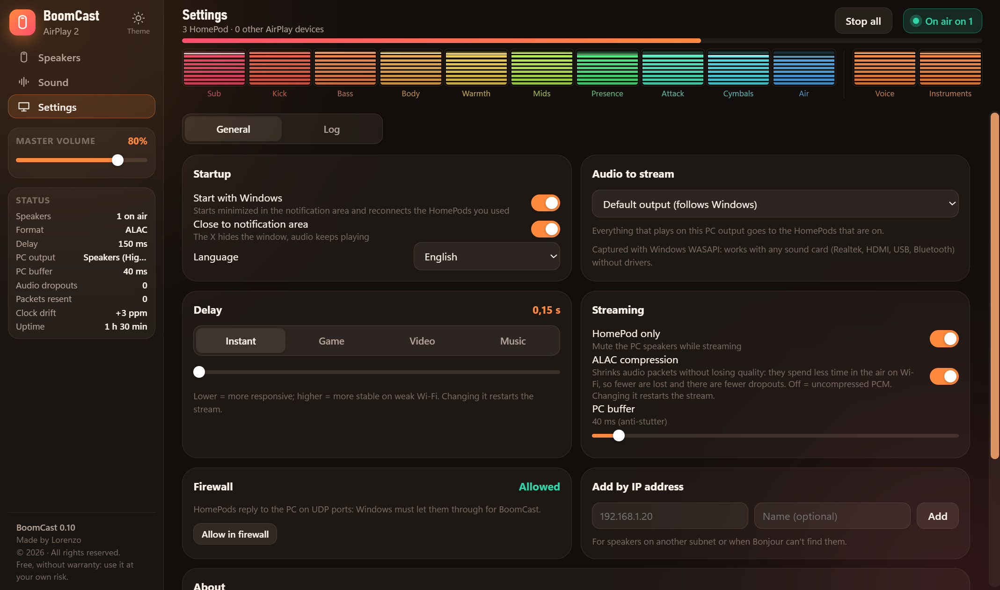

# BoomCast

**Play everything your Windows PC plays on your HomePod.**

BoomCast sends the PC's sound to HomePod and other AirPlay 2 speakers over your home network. Music, films, games, video calls: whatever comes out of Windows comes out of the speaker. No driver to install, no account, free.

**[Download BoomCast.exe](https://github.com/Lorenzo8484/BoomCast/releases/latest)** · [User guide](docs/guide.md) · *Italiano: [README.it.md](README.it.md)*

> BoomCast is an independent project. It is not affiliated with, endorsed by or approved by Apple. AirPlay, HomePod, HomeKit and iPhone are trademarks of Apple Inc.

## Why BoomCast

A HomePod sounds great, but Windows cannot play to it: AirPlay is built into Apple devices only. BoomCast fills that gap. It captures the sound of the PC as it is played and streams it to the speaker, so the HomePod becomes the PC's loudspeaker for anything, not only for one music app.

| | |
|---|---|
| **Any sound, any app** | It captures the Windows output itself, so it works with browsers, players, games and calls without setting up each one. |
| **Low delay** | From 0.15 s. Low enough to watch video and play; a higher setting is there for weak Wi-Fi. |
| **Lossless** | 44.1 kHz / 16 bit, as ALAC (smaller packets, fewer dropouts) or uncompressed PCM. |
| **Several speakers** | Switch on as many as you like; each has its own volume and fine delay. |
| **Shares with your phone** | When an iPhone plays on the HomePod, BoomCast steps aside and comes back by itself afterwards. |
| **No driver** | It uses the audio capture built into Windows. Nothing is installed in the system. |

## Speakers

Every speaker on your network gets a card: a switch to start streaming, its volume, an extra delay to line it up with other speakers or with the picture, and the options for sharing it with a phone.

When a phone starts playing on a speaker, BoomCast gives way at once. When the phone stops, a countdown appears next to the speaker's name (the "17 s" in the picture above) and the PC sound returns when it reaches zero. You choose how long that wait is, per speaker.

The column on the left shows what is going on: how many speakers are playing, the format, the delay, the Windows output being captured, and the health of the connection.

## Sound

- **Sound modes.** Nine built in: Flat, Bass+, Voice, Movie, Music, Night, Game, Spatial, Concert.
- **Each mode remembers you.** Move a slider while a mode is on and the change stays with that mode, also after a restart. An orange dot marks the modes you have changed; **Reset** puts the active one back to its original settings without touching the others.
- **Your own modes.** Save everything on the page under a name of your choice, as many as you want, and drag the buttons into the order you like.
- **10-band equaliser** from 31 Hz to 16 kHz with preamp, plus deep bass, brilliance and voice.
- **Spatial sound:** stereo width, surround, reverb with room size, channel blend, balance.
- **Dynamics:** compression, even volume across tracks, limiter against distortion, dithering.
- **Live meters:** a spectrum by band at the top, and left, centre, sides and right channel beside the equaliser, so you see what each control does.

## Settings

- **Delay** with four presets: *Instant* (0.15 s), *Game*, *Video*, *Music*, or any value with the slider.
- **Audio to stream:** the default Windows output or a specific one.
- **HomePod only:** mutes the PC speakers while streaming.
- **ALAC compression:** on by default; makes the stream more robust on Wi-Fi without losing quality.
- **Start with Windows** and **close to the notification area**, where a small panel gives you switches and volume without opening the window.
- **28 languages**, picked from Windows automatically, and a light and a dark theme.
- **Log** of what the app is doing, for when something does not work.

## Requirements

- Windows 10 or 11, 64-bit.
- Microsoft Edge WebView2 Runtime (already part of Windows 11 and of up-to-date Windows 10).
- A HomePod, HomePod mini or another AirPlay 2 speaker on the **same network** as the PC.
- In the Apple **Home** app: *Home Settings → Speakers & TVs → Allow Speaker & TV Access → Anyone on the Same Network*.

Developed and tested with a HomePod (2nd generation). Other AirPlay 2 speakers should work but have not been tested.

## Download and first start

1. Download `BoomCast.exe` from the [latest release](https://github.com/Lorenzo8484/BoomCast/releases/latest). There is nothing to install: put the file where you like and run it.
2. The file is not digitally signed, so Windows shows *"Windows protected your PC"*. Choose **More info → Run anyway**.
3. Your speakers appear under **Speakers**. Switch one on.
4. The first time, Windows Firewall must let the speaker's replies reach BoomCast: press **Allow in firewall** when the app asks and confirm the Windows prompt. This is needed once.

Every setting explained and a troubleshooting list: **[User guide](docs/guide.md)**.

## Good to know

- **Dropouts on Wi-Fi.** With a very low delay a packet lost on Wi-Fi cannot be recovered in time and you hear a click. If it happens, raise the delay and keep ALAC compression on.
- **Translations** were produced automatically and have not been reviewed by native speakers. The log is in Italian.
- **Privacy.** BoomCast talks only to the speakers on your local network. It collects nothing and sends nothing to the Internet. Settings stay on your PC, in `%APPDATA%\BoomCast`.
- BoomCast speaks AirPlay 2 without Apple's involvement, so a future update of the speaker's software may stop it from working until BoomCast is updated.
- The pictures on this page use made-up speaker names and addresses.

## Problems and suggestions

Open an [issue](https://github.com/Lorenzo8484/BoomCast/issues). Say which speaker you have, your Windows version, and attach the text of *Settings → Log*.

## Rights and disclaimer

© 2026 Lorenzo. All rights reserved. BoomCast is free for personal use; it may not be modified, decompiled, redistributed or sold without the author's written permission. It is provided "as is", without warranty of any kind: you use it at your own risk. Full terms: [LICENSE.md](LICENSE.md).

The source code is not published. BoomCast includes open-source libraries, listed with their licences in [THIRD-PARTY-NOTICES.md](THIRD-PARTY-NOTICES.md).
